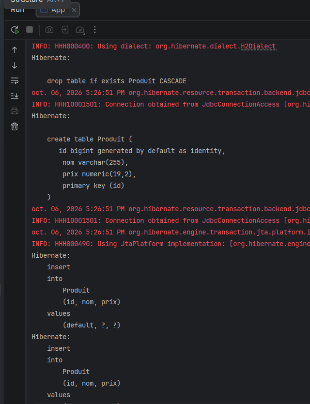
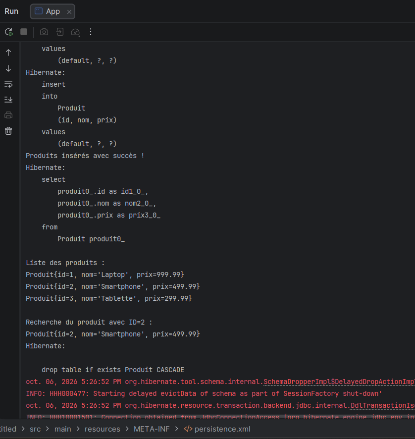
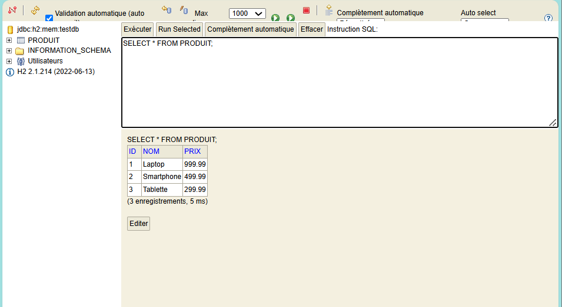
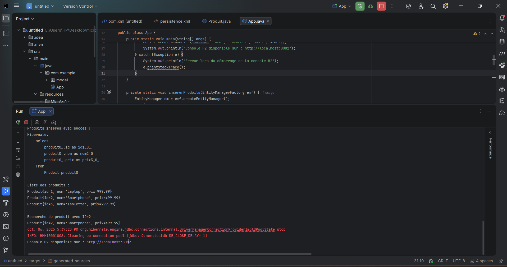

## Description
Application Java utilisant JPA et Hibernate avec une base H2 en mémoire.
Elle permet d'insérer et de lire des produits (entité `Produit`).

## Technologies
- Java
- Hibernate 5.6.5 / JPA
- H2 Database
- Maven
- IntelliJ IDEA
## Exécution dans IntelliJ

### 1. Création de la table Produit par Hibernate

### 2. Insertion, lecture et recherche des produits

### 3. Vérification des données dans la console H2

### 4. Vue d'ensemble de l'exécution dans IntelliJ
